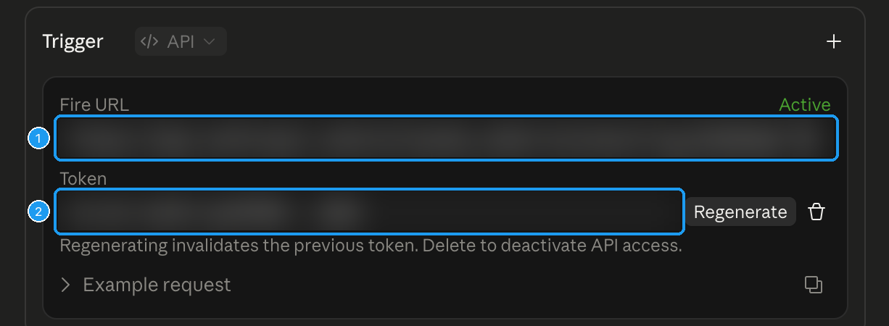

# Set up Send to Grok Bot

You were given this repository and asked to set it up. You are Grok Bot, Claude Code, ChatGPT, or Codex. Do the work yourself. The person should only have to do the clicks you cannot perform.

The person may have started with this one line:

Set up Send to Grok Bot for me: https://github.com/jamespendry/send-to-grok-bot

If you are Grok Bot, that line means: do the Grok Bot section, then reply with one connect link and nothing else they have to copy.

Read this file before you give instructions. The human steps in the README are for a person working alone. You are not that person.

## Rules

1. Do every step your tools and permissions allow. Reading this repo, creating the routine, and building the connection code are your job.
2. Speak to the person one step at a time. One action in a message. Wait until they tell you what they see. If it does not match the success line, fix that step before you send the next one.
3. Do not ask the person to paste a webhook key, routine token, or other secret into this chat. Tell them which box on the extension options page to paste it into.
4. When you can see both the address and the secret, return them as one connection code. They paste that code once, into the options page. They do not paste it back into this chat. Do not also print the raw key.
5. When you cannot see the secret, do not collect it. The person copies it from the routine page straight into the options page. A secret-request card is the wrong destination. The secret belongs in the extension, in `chrome.storage.local`, not in your notes.
6. Do not invent webhook URLs, `trig_` ids, or tokens. Copy them from the tool or the screen that created them.
7. Do not post, follow, or message anyone on X while you set this up.
8. Do not edit `extension/content.js`. Another change owns how posts are read.
9. Do not commit a connection code, a key, or a token. Do not put one in a GitHub issue, pull request, or chat log you file somewhere else.

## What done looks like

Chrome shows a button on each X post. The person clicks it and picks a destination you prepared.

- Grok Bot: a webhook routine exists, and the extension has its URL and key.
- Claude Code: an API task exists under Scheduled tasks, with the short task prompt from **Copy task prompt** and an API trigger, and the extension has its Fire URL and token. Runs show up under that task's History. If they cannot use tasks, Claude opens in a tab and no secret is stored.
- ChatGPT or Codex: no setup and no secret. They check the box and click Save. Clicking a post opens that product with the post filled in, and they press Send.

You cannot load an unpacked extension into their Chrome unless you are driving that Chrome window. Assume you are not. The last section is the walkthrough you give them.

## Which destination

If they named one, use it. If they did not, ask once which they want: Grok Bot, Claude, ChatGPT, or Codex. Then start. A second destination is a second connection code later. Do not make them choose a stack of options before the first one works.

## Connection code

A connection code is one string. It starts with `stgb1.` and the rest is base64url-encoded JSON. The options page reads it, fills that destination, and saves to `chrome.storage.local`. It does not keep the code string, and it does not send the code anywhere.

Build it with the repo, from the repo root:

```bash
node -e 'const {encodeConnectionCode}=require("./extension/connect.js"); console.log(encodeConnectionCode({destination:"chatgpt"}))'
```

`encodeConnectionCode` checks the fields and throws a plain-language error when something is missing. Use it. Do not hand-encode unless you cannot run Node. If you cannot, the JSON below is the whole format. UTF-8 JSON, base64url, no padding, prefix `stgb1.`

| Destination | JSON |
| --- | --- |
| Grok Bot | `{"destination":"grokbot","mode":"webhook","url":"https://...","key":"..."}` |
| Claude routine | `{"destination":"claude","mode":"routine","url":"https://api.anthropic.com/v1/claude_code/routines/trig_.../fire","token":"..."}` |
| Claude tab | `{"destination":"claude","mode":"link"}` |
| ChatGPT tab | `{"destination":"chatgpt","mode":"link"}` |
| ChatGPT agent | `{"destination":"chatgpt","mode":"agent","triggerId":"agtch_...","token":"..."}` |
| Codex | `{"destination":"codex","mode":"link"}` |

The key is optional for Grok Bot. For Claude, `url` is the **Fire URL** copied from Edit scheduled task. A routines page link or a bare `trig_` id also works. Do not build the URL yourself. Codex may also include `environment` and `branch`. Claude, ChatGPT, and Codex may include `prompt`. Grok Bot must not: the prompt lives on the routine, and the encoder rejects a Grok Bot code that contains one.

A Claude or ChatGPT `link` code clears a routine token already saved for that destination, so the button opens a tab. It does not clear the other destinations.

The link you send a person is:

`https://sendtogrokbot.com/connect#stgb1.<code>`

The hash is the code. There is no `connect=` in front of it. The page fills the box from that hash. If the extension is installed, Connect writes it into the extension. The options page accepts the same link in its paste box, and `options.html#connect=stgb1....` still works. Do not send a `chrome-extension://` link. Those links do not open reliably.

[docs/connect.html](docs/connect.html) is that page. It also accepts a webhook URL plus an Authorization header, or a Claude Fire URL plus a token, in any order. It does not upload what they paste. Do not ask them to paste the secret into chat so you can run the Node command.

## Grok Bot

Create a webhook-triggered routine yourself.

- Name: Send to Grok Bot
- Trigger: webhook
- Instruction: the prompt under the line in [prompts/general.md](prompts/general.md), unchanged. Do not include the title. That file is also [prompts/default-routine-prompt.md](prompts/default-routine-prompt.md).

If creating it shows a confirm card, that confirmation is one step. Ask, wait, then continue. Leave the routine on, not paused.

The routine prompt tells the bot to follow a `prompt` field on the post when one is present. The extension sends `preset` and `prompt` with every post, so the person can switch Research, Job hunt, Buy or skip, Learn later, or Content ideas on the options page without you editing the routine. Do not put a prompt inside the connection code. The encoder rejects it.

The create result often does not include the webhook URL or the key. Read them from the routine after it exists. Do not construct the URL. The phone app does not show these fields. Desktop does.

In the Grok Bot desktop app: open the bot's sidebar, open the Routines tab, and open this routine. At the bottom, When to run is Webhook and Method is POST. Copy the URL and the Authorization header. The header value is the key. Strip a leading `Bearer ` before you put it in the code. The extension adds `Bearer ` itself.

When you can read both, build a `grokbot` connection code. Your reply to the person is one link and no other secret:

`https://sendtogrokbot.com/connect#` plus the code.

Do not print the key on its own line. Do not also paste the raw URL. Do not ask them to paste the link back into this chat. Tell them to open it and click Connect, and to choose Allow if Chrome asks.

When you cannot read the URL or the header, do not invent them and do not send a link. Walk these clicks, one per message, and wait:

1. Open the bot's sidebar.
2. Open the Routines tab.
3. Open the routine named Send to Grok Bot.
4. At the bottom, When to run is Webhook and Method is POST. Copy the URL and the Authorization header.
5. Open https://sendtogrokbot.com/connect and paste both, in any order, then click Connect. They can instead paste the URL into Webhook URL and the header into Webhook key on the extension settings page, then click Save. The key box accepts the whole Authorization header.

The extension POSTs the post as JSON, including `preset` and `prompt`, and sends the key as `Authorization: Bearer <key>` and as `X-Sender-Key: <key>`. A 200 means the routine started. The reply shows up in the bot's chat when the run finishes.

## Claude Code

You cannot create a Claude routine from outside claude.ai. Do not claim that you did. If they only want a tab, build `{"destination":"claude","mode":"link"}` and send `https://sendtogrokbot.com/connect#` plus that code. No secret. Clicking a post opens claude.ai with the post filled in, and they press Send.

A routine that runs on its own needs a Claude Pro, Max, Team, or Enterprise plan with Claude Code on the web. The clicks below were checked against the product. Walk one step, then wait. Point them at the extension buttons instead of pasting the prompt or the host list yourself into chat.

1. On claude.ai, in the left sidebar, click **Scheduled**. Click **New task**, then **Set up manually**. Name it Send to Claude. In the extension settings, open Send to Claude and click **Copy task prompt**, then paste it into the instructions box. Set **Trigger** to **API**. Click **Create**.
2. Claude shows the **Fire URL** (`https://api.anthropic.com/v1/claude_code/routines/trig_...`) and the **Token**. The token is shown once. They copy both and paste them into https://sendtogrokbot.com/connect (or the box on the extension settings page), in any order, then click Connect. They do not paste either value into this chat. If they lose the token, they open the task, choose Edit from the menu next to its name, and click Regenerate. The old token stops working.



No network allowlist is needed. The extension sends the whole post, its thread, quote, links, and alt text, plus the reply preset, in the fire text. The task prompt tells Claude to use only that and fetch nothing, so the Default environment works as it is. Leave the environment alone.

If a checkbox offers to keep the usual package-manager sites too, turn it on. The task prompt does not commit or push. If the form will not save without a repository, ask which repo to attach and wait. Do not create a repository unless they ask.

Leave the task Active. Runs show up under History.

If you can see both the Fire URL and the token, build a `claude` routine connection code and send one link: `https://sendtogrokbot.com/connect#` plus the code. Do not print the token by itself. If you cannot see them, they paste both into the extension box. Not into this chat.

## ChatGPT

ChatGPT needs no setup. Say that in one sentence. They check **Send to ChatGPT**, leave the agent fields blank, and click Save. Clicking a post opens `chatgpt.com/?q=…` with the preset prompt and the post filled in. They press Send.

A connect link is optional. `{"destination":"chatgpt","mode":"link"}` only checks the box for them. Do not ask for a secret.

Do not set up a Workspace Agent unless they ask for a fully automatic run. That needs a Business or Enterprise workspace, an admin, an `agtch_` trigger id, and an access token. If they do ask and you cannot create the token, they paste the id into **API trigger ID** and the token into **Workspace Agent access token** on the options page. Not into this chat.

## Codex

Codex needs no setup. Say that in one sentence. They check **Send to Codex** and click Save. Clicking a post opens `https://chatgpt.com/codex` with the preset prompt and the post filled in. They press Send.

`{"destination":"codex","mode":"link"}` only checks the box. Add `environment` and `branch` only when they already gave you those values. Codex Cloud has no public webhook a normal ChatGPT account can call. Do not ask for an API key.

## Handoff

If the extension is already installed, do not walk through the download. For Grok Bot, the connect link is the whole handoff: they open it and click Connect. For ChatGPT and Codex, they check the box and click Save. There is nothing else to set up.

Do the steps below when they do not have the extension yet. Send one step. Stop. Wait for them to say what they see. Use these words, with their real file name filled in.

1. "Open the project page on GitHub in Chrome. Click the green Code button, then click Download ZIP. Tell me when a file whose name starts with send-to-grok-bot is in your Downloads folder."
2. "Double-click that zip. Open the folder inside it until you see a folder named extension. Open extension and tell me when you see a file named manifest.json. Then go back so extension is a folder you can select, not a window full of files."
3. "Click the address bar, type chrome://extensions, and press Enter. Tell me when the page title is Extensions."
4. "At the top right, turn Developer mode on. Tell me when a button named Load unpacked appears."
5. "Click Load unpacked. Select the extension folder, the one that contains manifest.json, and confirm. Tell me when a card named Send to Grok Bot appears and its switch is on. If Chrome says the manifest is missing, you selected the outer folder. Go back and select extension."
6. "Click the puzzle-piece icon on the Chrome toolbar. Beside Send to Grok Bot, click the pin. Tell me when that icon is sitting on the toolbar."
7. "Click that icon. Tell me when you see a page titled Send to Grok Bot with a box labeled Connect link."
8. Then one of these, not both:
   - You have a connection code: send `https://sendtogrokbot.com/connect#` plus the code. "Open this link and click Connect. If Chrome asks, choose Allow. Do not paste it back here." Success is a green line that starts with "Saved Send to" and names their destination.
   - They are the only ones who can see the secret. For Grok Bot: "In Grok Bot, open the bot's sidebar, open the Routines tab, and open the routine. At the bottom, copy the URL and the Authorization header. Paste both into the box on sendtogrokbot.com/connect and click Connect. Do not paste them here." For Claude: "On the task page, click the three dots next to Active, then Edit. Copy the Fire URL and the token. Paste both into the Fire URL and token box in the extension. Do not paste them here." Next message: "Click Save. Tell me when you see the word Saved." Remind them that Allowed websites is a separate step, after a run exists, under Edit cloud environment.

9. "Open x.com and refresh. On any post, click the arrow icon in the row with reply, repost, like, and share. Tell me which names you see." Success is the destination you set up. Then: "Click that name."
   - Grok Bot: the icon turns green, and a run shows up in the bot's chat. A 200 only means the run started.
   - Claude routine: the run is listed under History on the task page.
   - Claude, ChatGPT, or Codex tab: a new tab opens with the post written in the box. They press Send.
   - A red icon: read the line under the message at the bottom of the screen, and fix that one thing.

If they already have the folder, skip the download and start at the first step they have not done. Ask what they see. Do not replay finished steps.

## When something fails

- Chrome says it needs a manifest: they selected the folder that contains `extension`, not `extension` itself.
- Developer mode is off: Load unpacked is hidden. That is step 4.
- The menu on a post is empty and the options page opens: nothing is checked, or Grok Bot is checked without a webhook address.
- Grok Bot returns anything other than 200: the routine is paused, or the key is not the current one.
- Claude says the token is invalid: on the task page, open the menu next to the task name, click Edit, click Regenerate, paste that token into the extension's Fire URL and token box, and click Save. Regenerating invalidates the previous token.
- Claude says it cannot open the post: that is expected. It replies from the text the extension sent. If the reply says the post was empty, send it again from the post's own page so the thread is included.
- They pasted the code into this chat: tell them to paste it into the options page instead, and do not ask them to paste it again here.
