# Send to Grok Bot

Send any post on X to your AI with one click.

Tired of copying and pasting X posts into Grok Bot, Claude, ChatGPT, or Codex? Send to Grok Bot adds a Send button to every post on x.com. Click it, pick your AI, and the post goes there. It works on a computer in Chrome, and on iPhone through the share sheet (the menu that opens when you tap Share).

It is free and open source. There is nothing to buy and no account to make.

If you are an AI agent and someone asked you to set this up, read [AGENTS.md](AGENTS.md) instead.

### [Download the extension](https://sendtogrokbot.com/send-to-grok-bot.zip)

For Chrome on a Mac or Windows computer. On an iPhone, skip to [iPhone](#iphone).

The same steps, with buttons that check your progress, are at [sendtogrokbot.com](https://sendtogrokbot.com/install).

## 1. Install in Chrome

Send to Grok Bot is not in the Chrome Web Store yet, so Chrome needs a few extra clicks. You do this once.

1. **Download it.** Click [Download the extension](https://sendtogrokbot.com/send-to-grok-bot.zip).
2. **Unzip it.** Open your Downloads folder and double-click `send-to-grok-bot.zip`. You get a folder called `send-to-grok-bot`. Leave it there. On Windows, right-click the zip, then choose Extract All.
3. **Open Chrome's extensions page.** Copy this, paste it into the address bar at the top of Chrome, and press Enter:

   ```
   chrome://extensions
   ```

4. **Turn on Developer mode, then click Load unpacked.** Developer mode is a switch at the top right of that page. It lets Chrome load an extension from a folder on your computer. Switch it on, then click **Load unpacked** and choose the `send-to-grok-bot` folder from your Downloads.

   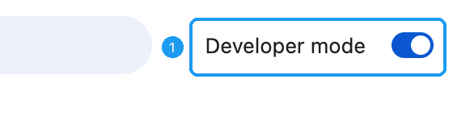

   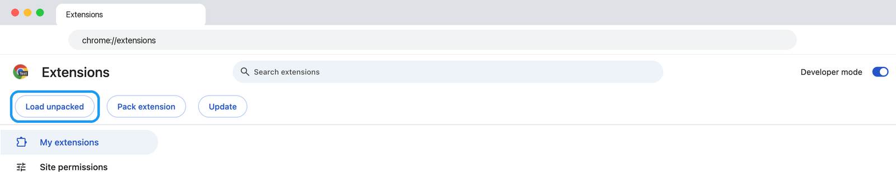

5. **Refresh.** A card named Send to Grok Bot now shows on the extensions page. If you have x.com open, refresh it so the button appears.

## 2. Choose your AI

Pick one. You can add more later. Chrome on a computer is the full experience: all four AIs work there.

| AI | What you need | Where the reply shows up |
| --- | --- | --- |
| [Grok Bot](#grok-bot) | The Grok Bot desktop app. Grok Bot sets itself up. You copy two lines. | In your Grok Bot chat. |
| [Claude](#claude) | A paid Claude plan (Pro or Max) to have Claude reply on its own. Any plan, including free, to open Claude in a tab instead. | On claude.ai, under Scheduled, Send to Claude, History. Or in a new tab. |
| [ChatGPT](#chatgpt) | Nothing to set up. Check one box. | A new ChatGPT tab with the post filled in. You press Send. |
| [Codex](#codex) | Nothing to set up. Check one box. | A new Codex task with the post filled in. You press Send. |

### Grok Bot

Do this on a computer.

1. **Send Grok Bot this line.** Paste it into any Grok Bot chat:

   ```
   Set up Send to Grok Bot for me: https://github.com/jamespendry/send-to-grok-bot
   ```

   It creates a routine named Send to Grok Bot and replies when it's done. A routine is a task Grok Bot runs by itself each time a post arrives. If it asks you to confirm, confirm.

2. **Open the routine.** Click the bot's name at the top of the chat. Under **Routines**, click **Send to Grok Bot**.

   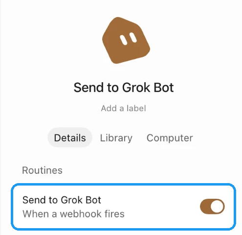

3. **Copy two lines into the connect page.** Open [sendtogrokbot.com/connect](https://sendtogrokbot.com/connect).
   - Copy **POST to**. It starts with `https://api2.cursor.sh/automations/webhook/`. Paste it into the box on the connect page. It says "Webhook URL saved."
   - Copy **header**. It starts with `Authorization: Bearer crsr_`. Paste it into the same box. It says "Now open x.com and click the arrow." The **key** line works too.

   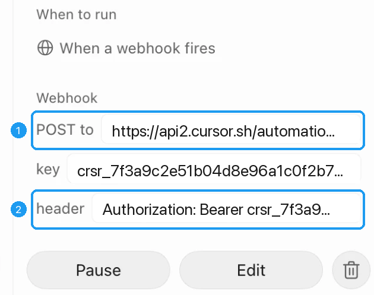

   The pictures show sample values, not real ones. The app cuts long values off with "…", but copying takes the whole value. Paste yours only on the connect page, never in a chat. If Chrome asks to allow a site, click Allow.

You're done. On x.com, click the Send arrow on any post. The icon turns green when the run starts, and the reply shows up in your Grok Bot chat.

To change the reply style later, leave the routine as it is. In the extension settings, under **Replies**, pick Research, Job hunt, Buy or skip, Learn later, or Content ideas. The routine follows it on the next post.

### Claude

There are two ways. Pick one.

**Claude replies on its own.** This needs a paid Claude plan (Pro or Max). You make a task on claude.ai that runs each time you send a post.

1. **Start a new task.** Open Claude's [Scheduled page](https://claude.ai/code/routines). At the top right, click **New task**, then **Set up manually**.

   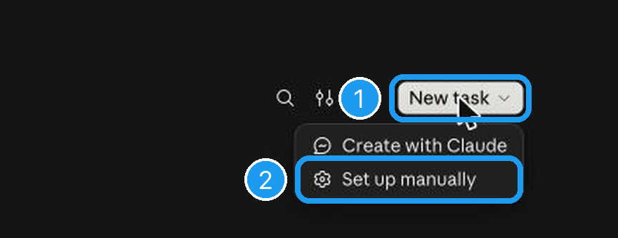

2. **Fill in the form.**
   - **Name:** type `Send to Claude`.
   - **Instructions:** click the Send to Grok Bot icon in Chrome to open its settings. If you don't see the AI checkboxes, click **More options**. Check **Send to Claude**, then click **Copy task prompt**. Paste it into the big box.
   - **Trigger:** click Schedule and choose **API**.
   - Click **Create**. Leave everything else as it is.

   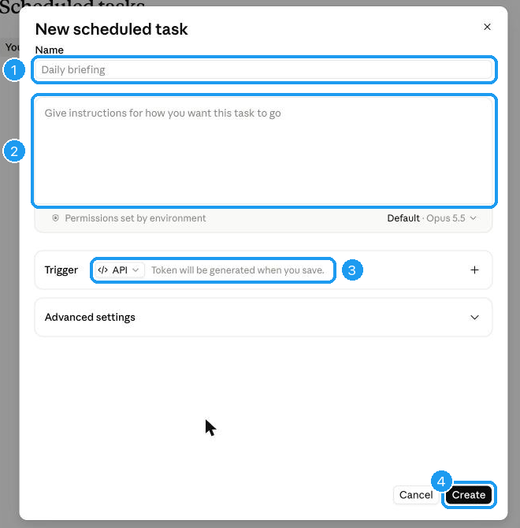

3. **Paste your Claude key on the connect page.** Claude now shows your key in a box called **API token**. Claude shows it only once. Click its copy button, open [sendtogrokbot.com/connect](https://sendtogrokbot.com/connect), and paste it into the box. It saves as soon as you paste. Then go back to Claude and click **Done**.

   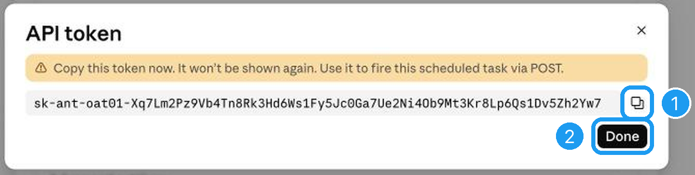

4. **Paste the task link too.** Claude opens your new task. Under **Triggers**, click the copy button next to **API**. Paste it into the same box on the connect page. If Chrome asks to allow api.anthropic.com, click Allow.

   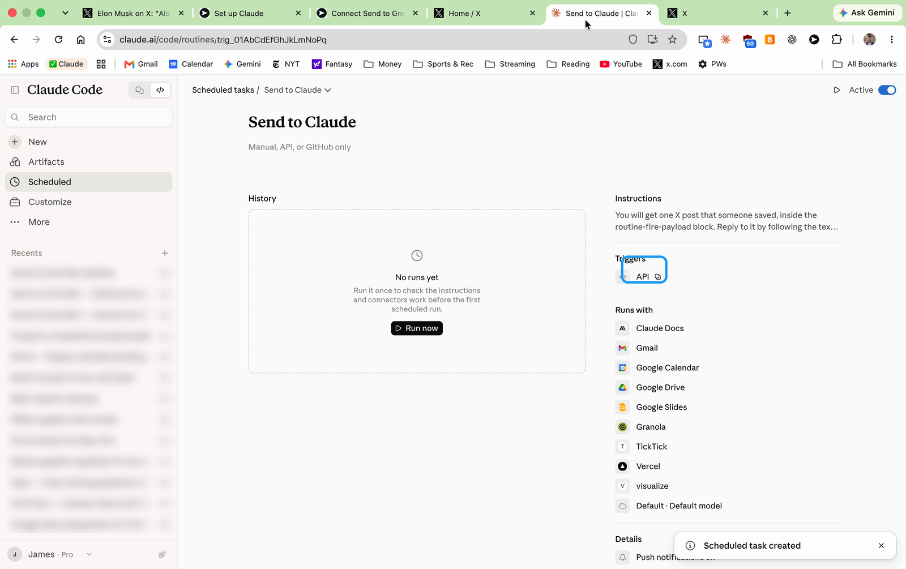

Keep the token private. Paste it only on the connect page, never in a chat or an email.

You're done. Open x.com, refresh, click the Send arrow on any post, and choose Send to Claude. The icon turns green when Claude starts. To read the reply, open the [Scheduled page](https://claude.ai/code/routines), then Send to Claude. Each post you send is a line under **History**.

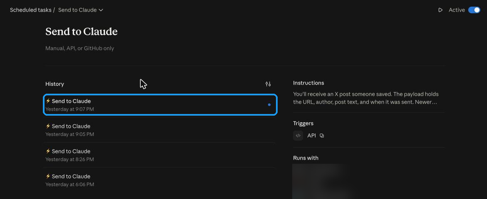

If you use Claude in Chrome, Claude can make the task and connect the extension for you. It never sees your token. Send Claude this line, then click Allow when Chrome asks:

```
Set up Send to Grok Bot for me, with Claude: https://github.com/jamespendry/send-to-grok-bot
```

Lost the token, or Claude says it's invalid? On the Scheduled page, open Send to Claude. Click the small arrow next to its name, then **Edit**. Under Trigger, click **Regenerate** and copy the new token. The old one stops working. Paste the new token on the [connect page](https://sendtogrokbot.com/connect).

**Claude opens in a tab.** Works on any plan, including free. Open the extension settings and click **More options** if it's closed. Check **Send to Claude**, leave the box labeled Fire URL and token empty, and click **Save**. Clicking a post opens Claude in a new tab with the post filled in. You press Send.

### ChatGPT

Nothing to set up.

1. Click the Send to Grok Bot icon in Chrome to open its settings. If you don't see the checkboxes, click **More options**. Check **Send to ChatGPT** and click **Save**.
2. On x.com, click the Send arrow on any post and choose Send to ChatGPT. ChatGPT opens in a new tab with the post and your reply style already filled in.
3. Press Send in ChatGPT. Make sure you're signed in to ChatGPT in this browser.

On ChatGPT Business or Enterprise, posts can run on a workspace agent instead of opening a tab. In the extension, under Send to ChatGPT, open **Workspace agent** and paste the API trigger ID and access token. Most people can skip this.

### Codex

Nothing to set up.

1. Click the Send to Grok Bot icon in Chrome to open its settings. If you don't see the checkboxes, click **More options**. Check **Send to Codex** and click **Save**.
2. On x.com, click the Send arrow on any post and choose Send to Codex. Codex opens a new task with the post and your reply style already filled in. It works well for tools, repos, and how-tos.
3. Press Send in Codex. Make sure you're signed in to Codex in this browser.

If you already have a Codex environment and branch, you can fill them in under Send to Codex, **Environment and branch**. Leave them blank and Codex still opens.

## 3. Try it

1. Open [x.com](https://x.com/home). If it's already open, refresh the page once so the button appears.
2. Click the Send arrow on any post. It's the small arrow at the right end of the row under each post. If you set up more than one AI, pick one from the menu.
3. See the reply:
   - **Grok Bot:** the reply arrives in your Grok Bot chat.
   - **Claude:** on claude.ai, open Scheduled, then Send to Claude. Each post is a line under History. Use Discuss in chat to keep talking.
   - **ChatGPT or Codex:** a new tab opens with the post filled in. Press Send there.

Every reply starts with a link to the post, so you can always find it again.

If the icon turns red, a line at the bottom of the screen says why.

## iPhone

Send any post from the X app to Grok Bot without leaving X, or open it in Claude or ChatGPT. Setup happens on the iPhone, at [sendtogrokbot.com/mobile](https://sendtogrokbot.com/mobile) in Safari:

1. **Install.** Tap Install Send to Grok Bot, then Add Shortcut.
2. **Make the routine.** Tap Copy setup message, then Open Grok Bot, and paste it into a chat. Skip this if you already have the Send to Grok Bot routine.
3. **Connect.** In Grok Bot, tap Grok Bot at the top of the chat, then Routines, then Send to Grok Bot. Tap the URL row, come back and tap Paste address. Tap the Header row, come back and tap Paste key.
4. **Finish.** Tap Finish. Shortcuts opens for a moment; allow it to save a file. You'll see "Connected to Grok Bot".

Then, in X, tap the share arrow under a post, then Share via…, then Send to Grok Bot. A "Sent to Grok Bot" notice appears and the reply arrives in your Grok Bot chat.

| 1. Tap Share via… | 2. Tap Send to Grok Bot |
| --- | --- |
| 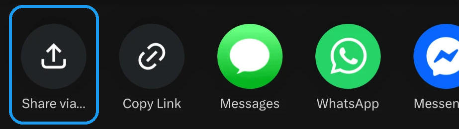 | 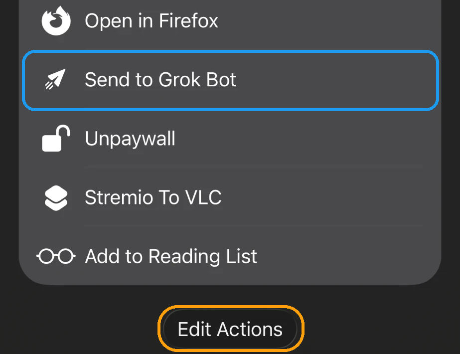 |

To keep it near the top: open the same list, scroll to the bottom, tap Edit Actions, then the green plus next to Send to Grok Bot.

**Claude or ChatGPT:** skip steps 2 to 4. The Shortcut then asks which AI and opens it with the post filled in; press Send. Picking Grok Bot there copies the message and opens Grok Bot to paste. Codex works only from the Chrome extension.

## Privacy

- The extension sends only the posts you click, and only to the AI you pick. On a post's own page it also sends the author's thread and the post it replies to.
- It does not track your browsing, use analytics, or sell data.
- Keys and tokens stay in Chrome on your computer. They are not synced to your Google account. If you turn on the optional Relay, they are stored encrypted on the relay instead.
- To get a post's full text, it looks the post up on the public mirrors api.fxtwitter.com and api.vxtwitter.com. Only the post's public link is sent to them.
- The iPhone Shortcut sends the post link to sendtogrokbot.com to look up the post's text. Once connected, the relay passes it to your Grok Bot webhook; the webhook key is stored encrypted on the relay, which keeps a short list of recent sends (the link and author, not the text).

Read the full [privacy policy](https://sendtogrokbot.com/privacy).

Not affiliated with X, xAI, Anthropic, or OpenAI.

## For developers

### Repository layout

| Folder | What it is |
| --- | --- |
| [`extension/`](extension/) | The Chrome extension (Manifest V3). `destinations/` has one file per AI. |
| [`docs/`](docs/) | The sendtogrokbot.com website. [site/README.md](site/README.md) maps each URL to its file. |
| [`site/`](site/) | `wrangler.toml` that serves the built site as a Cloudflare Worker with static assets. |
| [`relay/`](relay/) | Cloudflare Worker at relay.sendtogrokbot.com, for the iPhone Shortcut and the optional relay mode. |
| [`shortcuts/`](shortcuts/) | The iPhone Shortcut: `build.py` and the signed file the site serves. |
| [`prompts/`](prompts/) | Reply presets. [general.md](prompts/general.md) is the default and the Grok Bot routine prompt. |
| [`plugin/`](plugin/) | The Grok Bot marketplace plugin. Form answers are in [plugin/SUBMIT.md](plugin/SUBMIT.md). |
| [`store/`](store/) | Chrome Web Store listing text, promo images, privacy policy source, and upload steps. |
| [`scripts/`](scripts/) | `package.sh` (extension zip) and `build-site.sh` (website). |
| [AGENTS.md](AGENTS.md), [CLAUDE.md](CLAUDE.md) | Setup steps for an AI agent that is asked to set this up for someone. |

### Extension zip

```bash
bash scripts/package.sh
```

Writes `dist/send-to-grok-bot-<version>.zip` with `manifest.json` at the root. It checks every JavaScript file, the manifest permissions, the icons, the exact list of files in the zip, and that the store listing and privacy policy still match. The site serves this zip as `/send-to-grok-bot.zip`.

### Website

```bash
bash scripts/build-site.sh
```

Copies `docs/` to `dist/site`, builds the extension zip into it, adds `connect.js`, `prompts.js`, the icons, the logo sprite, and the signed Shortcut, then fails if a page has unbalanced tags or `/connect` lost an id the extension needs. Open `dist/site` with any static server to check it. Short URLs such as `/install` come from `docs/_redirects`, so a plain static server needs the `.html` name.

`extension/site-connect.js` runs on `sendtogrokbot.com/connect` and saves what you paste there into the extension. Keep the `paste`, `msg`, `installed`, and `install-steps` ids and the `data-stgb-ready` attribute on that page. The build checks `paste` and `msg`.

### Relay

The relay is optional for Chrome. With **Relay** checked on the options page, the extension stores one `stgbr1.` code, and the Grok Bot webhook key and Claude token stay on the relay, encrypted. Once connected (the /mobile page saves the webhook with `PUT /v1/config` and hands the code to the Shortcut, which keeps it in `Shortcuts/Send to Grok Bot/connect-code.txt` in iCloud Drive), the iPhone Shortcut posts to `/v1/send` with `format: "text"`; the relay adds the post's context, forwards it to the saved Grok Bot webhook, and answers in one line. Without one it uses `/v1/open`, which needs no code: it looks up the post and returns a link that opens Claude or ChatGPT, or text to paste into Grok Bot.

```bash
cd relay
npm install
npm test
```

Tests use Vitest with the Cloudflare Workers pool, plus Node's test runner for `test/node/unit.test.mjs`. The other files in `test/node/` run with `node --test test/node/`. Deploy steps, the database, and the encryption secret are in [relay/DEPLOY.md](relay/DEPLOY.md).

### iPhone Shortcut

`shortcuts/build.py` writes the unsigned source, `shortcuts/Send to Grok Bot.shortcut`. iOS only installs signed Shortcuts, so after any change, rebuild and re-sign on a Mac signed in to iCloud:

```bash
python3 shortcuts/build.py && plutil -convert binary1 -o /tmp/in.shortcut "shortcuts/Send to Grok Bot.shortcut" && shortcuts sign --mode anyone --input /tmp/in.shortcut --output "shortcuts/Send to Grok Bot (signed).shortcut"
```

The name must stay **Send to Grok Bot**, because that is the label in the share sheet. Details are in [shortcuts/BUILD.md](shortcuts/BUILD.md).

### Deploys

Website, after `bash scripts/build-site.sh`:

```bash
npx wrangler deploy --config site/wrangler.toml
```

Relay, from `relay/`:

```bash
npx wrangler deploy
```

A push to GitHub does not deploy either one.

### What a webhook receives

Grok Bot, and any other webhook, gets a `POST` with `Content-Type: application/json`. If a key is saved, it is sent as `Authorization: Bearer <key>` and as `X-Sender-Key: <key>`. Any 2xx response means the run started. Zapier, Make, or n8n work too.

```json
{
  "source": "x",
  "version": 2,
  "url": "https://x.com/user/status/123",
  "author": "user",
  "authorName": "Display Name",
  "text": "Post text, with t.co links replaced by their full URLs",
  "postedAt": "2026-10-15T22:58:00.000Z",
  "truncated": false,
  "links": [{"text": "https://github.com/foo/bar", "url": "https://github.com/foo/bar", "href": "https://t.co/abc"}],
  "media": [
    {"type": "image", "alt": "Alt text", "url": "https://pbs.twimg.com/media/abc?format=jpg&name=large"},
    {"type": "video", "duration": 15, "thumbnail": "https://pbs.twimg.com/ext_tw_video_thumb/1/pu/img/abc.jpg?name=large", "captions": "Visible caption"},
    {"type": "gif", "duration": null, "thumbnail": "https://pbs.twimg.com/tweet_video_thumb/abc?format=jpg&name=large", "captions": ""}
  ],
  "card": {"href": "https://t.co/xyz", "text": "example.com | Title | Description"},
  "metrics": "3 replies, 10 reposts, 99 likes, 5000 views",
  "quoted": {"author": "other", "authorName": "Other", "text": "Quoted text", "postedAt": "…", "links": []},
  "inReplyTo": {"url": "https://x.com/other/status/122", "author": "other", "text": "Parent text"},
  "thread": [{"url": "https://x.com/user/status/123", "text": "1/", "postedAt": "…"}],
  "digest": "Plain-text rendering of all of the above",
  "sentAt": "2026-10-15T23:00:00.000Z",
  "preset": "general",
  "prompt": "The reply instructions for the preset you picked"
}
```

`url`, `author`, `text`, and `sentAt` are always present. The rest are best effort and may be empty or `null`. `thread` and `inReplyTo` come from the post's own page, or from the public mirrors when they answer, so they can be empty. More fields may appear, such as `context` (where the conversation came from) and `url` or `media` on `quoted`; see `extension/enrich.js`. Text fields are capped at 20,000 characters and threads at 25 posts. If your receiver passes a single text field to an AI, forward `digest`.

`preset` is `general`, `research`, `job-hunt`, `buy-or-skip`, `learn-later`, `content-ideas`, or `custom`, and `prompt` is its text from [prompts/](prompts/). A Claude routine receives `{"text": "..."}` with the prompt in front of the post. Claude, ChatGPT, and Codex tab links are prefilled with the prompt and the post, trimmed to stay under about 8,000 characters for Claude and 6,000 for ChatGPT and Codex.

### Logos

Menu marks are inline SVGs: Grok, Claude, and Codex from [@lobehub/icons](https://www.npmjs.com/package/@lobehub/icons) (MIT), and the OpenAI mark from [Simple Icons](https://simpleicons.org/) (CC0).

## License

MIT
