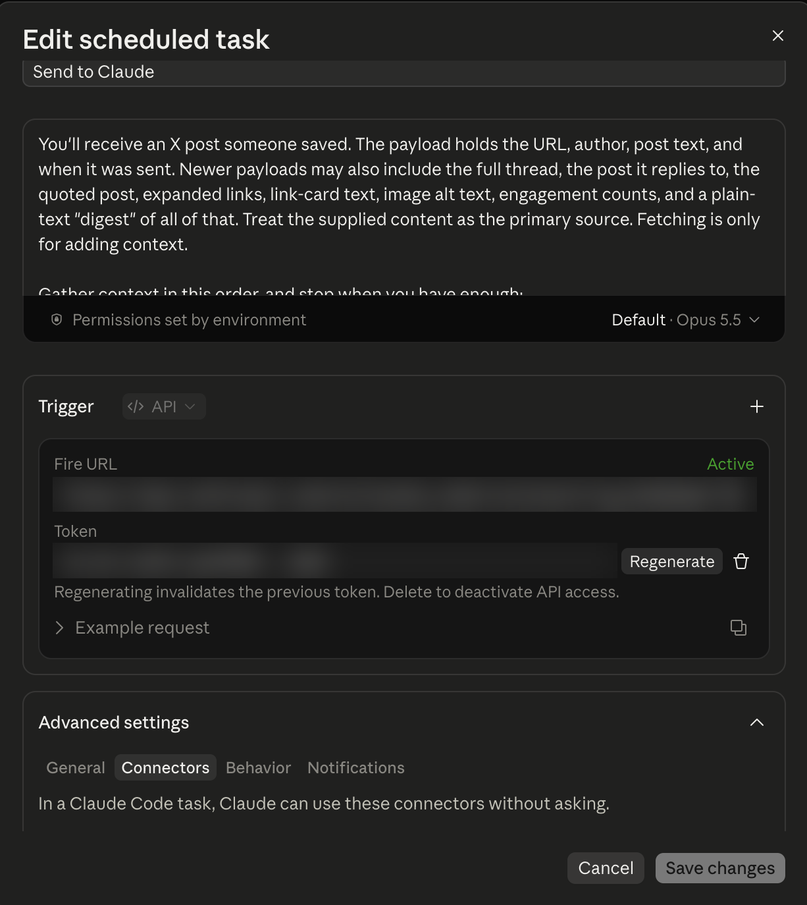
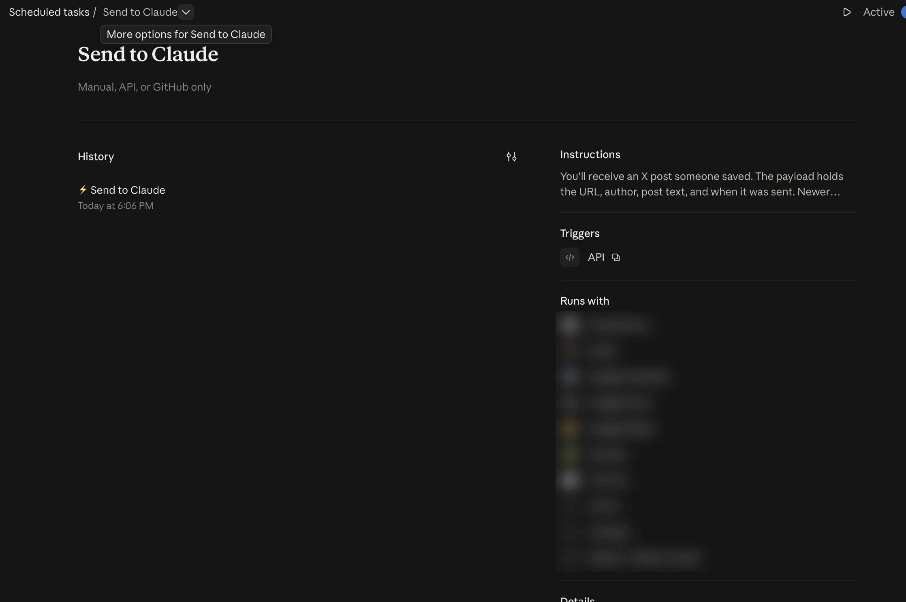

# Send to Grok Bot

A Chrome extension that puts a button on every post on X. You click the button, pick where the post should go, and that tool reads it.

If you are an AI agent and someone asked you to set this up, stop here and follow [AGENTS.md](AGENTS.md). Do the parts you can. Walk them through the rest one step at a time.

People: the steps below install it from a folder. Store listing text, promo images, and the upload steps are in [store/](store/). `scripts/package.sh` writes the zip.

## Set it up

You need Chrome on a computer. Each step is one action. After it, you should see the thing in the "You should see" line. If you do not, stay on that step.

### 1. Download the zip

Open this project on GitHub. Click the green **Code** button. Click **Download ZIP**.

You should see a file in your Downloads folder whose name starts with `send-to-grok-bot` and ends with `.zip`.


### 2. Unzip it

Double-click the zip.

You should see a folder. Open it until you see another folder named `extension`. Open `extension`. You should see a file named `manifest.json`. Then go back, so `extension` is a folder you can select in a later step.


### 3. Open the extensions page

Open Chrome. Click the address bar. Type `chrome://extensions` and press Enter.

You should see a page titled Extensions.


### 4. Turn on Developer mode

On that page, at the top right, turn **Developer mode** on.

You should see a button named **Load unpacked**.


### 5. Load the extension

Click **Load unpacked**. Select the `extension` folder (the one that contains `manifest.json`). Confirm.

You should see a card named **Send to Grok Bot**, with its switch on. If Chrome says the manifest is missing, you selected the outer folder. Go back and select `extension`.


### 6. Pin it

Click the puzzle-piece icon on the Chrome toolbar. Beside **Send to Grok Bot**, click the pin.

You should see the Send to Grok Bot icon on the toolbar.


### 7. Open the settings

Click that toolbar icon.

You should see a page titled **Send to Grok Bot**, with a box labeled **Connection code** and a list of destinations.


### 8. Turn on a destination

If someone gave you a connection code, click the **Connection code** box, paste the whole code, and click **Connect**.

You should see a green line that starts with "Saved Send to" and names that destination. The code starts with `stgb1.`. Paste it only on this page, not into a chat. Another code later adds another destination. It does not erase the ones already saved.

If you do not have a code:

- **ChatGPT** or **Codex**: check that box, leave the other fields blank, and click **Save**. You should see the word Saved. No password.
- **Grok Bot**: check **Send to Grok Bot**. Paste the webhook address into **Webhook URL** and the key into **Webhook key**. Click **Save**. You should see the word Saved.
- **Claude**, opening a tab: check **Send to Claude**, leave the routine fields blank, and click **Save**. You should see the word Saved.
- **Claude**, a routine: check **Send to Claude**. Paste the **Fire URL** into **Routine URL** and the token into **Routine token**. Click **Save**. You should see the word Saved. The Claude section below shows the task screen those two values come from.

Saving a webhook, a Claude routine, or a ChatGPT agent asks Chrome for access to that site only. Opening Claude, ChatGPT, or Codex in a tab does not. A webhook address has to be https. If Chrome asks you to allow the site, choose Allow.

The address and the key are on the routine's own page. For Grok Bot, that is the routine's Webhook section: **POST to** and **key**, on the desktop app. For Claude, open the task, choose Edit, and copy **Fire URL** and **Token**. To get a new token, click the task, choose Edit, and click **Regenerate**. Put the token in the box on this page. Do not send it to anyone.


## Try it

Open [x.com](https://x.com) and refresh. On a post, look at the row with reply, repost, like, and share. Click the arrow icon in that row.

You should see a menu with the destinations you turned on. Click one.

- Grok Bot or a Claude routine: the icon turns green when the send is accepted.
- ChatGPT, Codex, or Claude with the routine fields left blank: a new tab opens with the post already written in the box. You press Send.

If the icon turns red, a line at the bottom of the screen says why. If nothing is set up, the settings page opens.


## Screenshots to take

The pictures above are placeholders. Take these and save them under `docs/img/` with these file names.

| File | What to capture |
| --- | --- |
| `docs/img/01-download-zip.png` | The GitHub Code menu, with Download ZIP visible |
| `docs/img/02-unzipped-folder.png` | The unzipped folder, with `extension` open and `manifest.json` visible |
| `docs/img/03-chrome-extensions.png` | The address bar showing `chrome://extensions`, and the Extensions page |
| `docs/img/04-developer-mode.png` | Developer mode on, and the Load unpacked button |
| `docs/img/05-load-unpacked.png` | The folder picker selecting `extension`, and the Send to Grok Bot card |
| `docs/img/06-pin.png` | The puzzle-piece menu, with Send to Grok Bot and the pin |
| `docs/img/07-options.png` | The options page, showing the Connection code box |
| `docs/img/08-destinations.png` | A destination checked, its fields, and the word Saved |
| `docs/img/09-post-button.png` | The arrow icon in an X post's action row |
| `docs/img/10-menu.png` | The destination menu open on a post |

## Where a connection code comes from

A connection code is one string that fills one destination. An agent that set up the routine can hand you that string. You can also make one on your own computer: open `docs/connect.html` from the unzipped folder (double-click it). It builds the code in the browser and does not send it anywhere. Copy the code into the options page.

A link of the form `options.html#connect=` followed by the code also fills the page, and then the page removes it from the address bar. Links that start with `chrome-extension://` do not open reliably from a web page, so the box is the way to paste it.

The page stores the address and the key in `chrome.storage.local` on this computer. It does not keep the code string.

## What gets sent

Grok Bot, and any other webhook, receives `POST` with `Content-Type: application/json`:

```json
{
  "source": "x",
  "version": 2,
  "url": "https://x.com/user/status/123",
  "author": "user",
  "authorName": "Display Name",
  "text": "Post text, with t.co links replaced by their full URLs",
  "postedAt": "2026-10-15T22:58:00.000Z",
  "truncated": false,
  "links": [{"text": "https://github.com/foo/bar", "url": "https://github.com/foo/bar", "href": "https://t.co/abc"}],
  "media": [
    {"type": "image", "alt": "Alt text", "url": "https://pbs.twimg.com/media/abc?format=jpg&name=large"},
    {"type": "video", "duration": 15, "thumbnail": "https://pbs.twimg.com/ext_tw_video_thumb/1/pu/img/abc.jpg?name=large", "captions": "Visible caption"},
    {"type": "gif", "duration": null, "thumbnail": "https://pbs.twimg.com/tweet_video_thumb/abc?format=jpg&name=large", "captions": ""}
  ],
  "card": {"href": "https://t.co/xyz", "text": "example.com | Title | Description"},
  "metrics": "3 replies, 10 reposts, 99 likes, 5000 views",
  "quoted": {"author": "other", "authorName": "Other", "text": "Quoted text", "postedAt": "…", "links": []},
  "inReplyTo": {"url": "https://x.com/other/status/122", "author": "other", "text": "Parent text"},
  "thread": [{"url": "https://x.com/user/status/123", "text": "1/", "postedAt": "…"}],
  "digest": "Plain-text rendering of all of the above",
  "sentAt": "2026-10-15T23:00:00.000Z"
}
```
`url`, `author`, `text` and `sentAt` are always present. The rest are best-effort and may be empty or `null`. `thread` and `inReplyTo` are filled only when you click from a post's own page (`/status/…`), where X renders the conversation. Text fields keep line breaks and are capped at 20,000 characters. Threads are capped at 25 posts, in a window that still contains the post you clicked; `digest` prints that post's text even when it falls outside the window. Photo `url`s and video/GIF `thumbnail`s on `pbs.twimg.com` use `name=large`. A thumbnail is the `<video poster>` or an `ext_tw_video_thumb` / `amplify_video_thumb` / `tweet_video_thumb` image. `captions` is the text visible in the player, not a downloaded transcript. If your receiver passes a single text field to an AI, forward `digest`.

If a key is set, it is sent as `Authorization: Bearer <key>` and as `X-Sender-Key: <key>`.

The routine's job is the prompt in [prompts/default-routine-prompt.md](prompts/default-routine-prompt.md). It reads the post as data, classifies it, leads with a one-line takeaway, and does not post or contact anyone. Paste the text under the line in that file into the routine. Leave the prompt boxes in the extension blank to use a shorter version of the same idea when a tab opens.

For a Claude Code routine prompt that uses this payload, see [docs/routine-prompt.md](docs/routine-prompt.md).

The menu sends this same object to the destination you pick. Grok Bot posts the JSON. Claude, ChatGPT, and Codex receive that object too, and use `digest` when the destination can only take a single text field.

## Privacy
The extension sends only the posts you click (plus, on a post's page, the author's thread and the post it replies to), and only to the destination you pick. It does not track browsing, collect analytics, or sell data. Addresses, tokens, and keys are stored in `chrome.storage.local`. A webhook URL and key from an earlier version are copied out of `chrome.storage.sync` once, then removed there. Host access is optional and is limited to the webhook host, `api.anthropic.com`, or `api.chatgpt.com` after you save that destination. The policy to publish at sendtogrokbot.com/privacy is [store/privacy-policy.md](store/privacy-policy.md).

## Chrome Web Store
Listing text, promo images, and the upload steps are in [store/](store/). `scripts/package.sh` writes `dist/send-to-grok-bot-<version>.zip`. Screenshots of x.com are not in that zip. The shot list is in [store/listing.md](store/listing.md).

## How each destination works

### Grok Bot

Check **Send to Grok Bot** and save a webhook URL. The key is optional. Any webhook that accepts the JSON above will do, including Zapier, Make, or n8n. For Grok Bot itself, the webhook is a routine whose trigger is a webhook. The desktop routine page shows **POST to** and **key**. A response of 200 means the run started. The reply shows up in the bot's chat.

### Claude

Check **Send to Claude**.

Leave the routine fields blank to open claude.ai in a new tab with the post filled in. You press Send. Very long posts are shortened. This uses the `claude.ai/new?q=` link.

To run it for you, save the task's Fire URL and token. You need a Claude Pro, Max, Team, or Enterprise plan with Claude Code on the web. Tasks live at [claude.ai/code/routines](https://claude.ai/code/routines). That page is titled **Scheduled tasks**.

1. Click **New task**, then **Set up manually**.
2. Name the task Send to Claude.
3. Paste the prompt under the line in [prompts/default-routine-prompt.md](prompts/default-routine-prompt.md) into the instructions.
4. In the **Trigger** section, choose **API**.
5. Save the task.
6. Click the task, then Edit. **Edit scheduled task** shows **Fire URL**, with a copy button, and **Token**, with **Regenerate** and a delete button.



7. Copy the **Fire URL** and paste it into **Routine URL** on the extension options page.
8. Copy the token and paste it into **Routine token**. Click **Save**. You should see the word Saved.

Open the task. You should see **History**, **Instructions**, **Triggers** (API, with a copy icon), and **Runs with**.



A send shows up under **History**.

To get a new token, click the task, choose Edit, and click **Regenerate**. Regenerating invalidates the previous token. Paste the new token into **Routine token** and click **Save**. The delete button next to Regenerate turns off API access.

The task says permissions are set by the environment. Claude's default network blocks most sites, so the routine cannot open the post. In the environment settings, set **Network access** to **Custom** and allow `api.fxtwitter.com`, `fxtwitter.com`, `api.vxtwitter.com`, `vxtwitter.com`, `x.com`, `twitter.com`, and `t.co`, one per line. If a box offers to keep the usual package-manager sites too, turn it on.

The API is experimental and may change. Limits are 30 sends an hour per routine and 100 an hour per account. Runs count against the Claude plan. The extension sends the post as `{"text": "..."}`. The token only starts that one routine.

### ChatGPT

Check **Send to ChatGPT**.

Leave the agent fields blank to open `chatgpt.com/?q=…` with the post filled in. You press Send. Long posts are trimmed so the link stays under about 6,000 characters. The post URL is always included. This is a normal chat. Custom GPT links ignore the prompt.

A Workspace Agent (ChatGPT Business or Enterprise) runs on its own when an `agtch_…` trigger id and an access token are both saved. Each send is `POST https://api.chatgpt.com/v1/workspace_agents/{id}/trigger`. ChatGPT replies `202 Accepted`.

A Gmail-triggered task for Plus and Pro is not built. It would need a relay that emails the post to you.

### Codex

Check **Send to Codex**. Codex Cloud does not offer a public webhook a normal ChatGPT account can call. **Send to Codex** opens `https://chatgpt.com/codex` with the post filled in, and you press Send. An environment id and a branch are optional. Long posts are shortened so the link stays under about 6,000 characters.

## Logos

Menu rows and the line at the bottom of the screen use small inline SVGs.

- Grok: Grok mark from [@lobehub/icons](https://www.npmjs.com/package/@lobehub/icons) (MIT).
- Claude: Claude starburst from @lobehub/icons, colored `#D97757`.
- ChatGPT: OpenAI mark from [Simple Icons](https://simpleicons.org/) (CC0).
- Codex: Codex mark from @lobehub/icons.

Label text uses the brand color. Claude is `#D97757`. ChatGPT, Codex, and Grok Bot are black on a light surface and white on a dark one. The menu follows X's light and dark surfaces and X's font.

## Roadmap

- Submit the listing prepared in [store/](store/) so install is one click and Developer mode is not required.

## License

MIT
